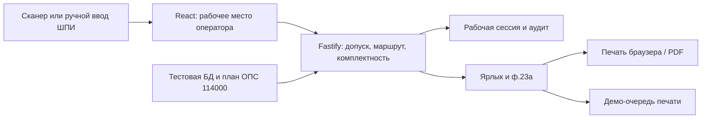

# Исходящая почта · ОПС 114000

Веб-прототип для хакатона АО «Почта России». Оператор собирает исходящие отправления по ШПИ, оформляет ёмкости и общую накладную ф.23а, затем сверяет места и подтверждает передачу водителю. Сервер рассчитывает допуск к отправке и маршрут, проверяет массу, дубли, принадлежность рейсу и состав передаваемой партии.

**Для демонстрации используются синтетические ФИО, адреса, индексы и даты.**

## Киллер-фича — рейс с проверкой плана и факта

План рейса работает и на сборке, и перед вывозом. Например, оператор планирует отправление на утренний рейс и случайно сканирует его на вечернем. Интерфейс показывает название правильного рейса, а сервер отклоняет вложение. Перед передачей система сверяет два списка: запланированные ШПИ с действующими накладными и отсканированные ярлыки ёмкостей с выбранной ф.23а.

- **На сборке** сервер подбирает открытую ёмкость нужного рейса, направления, группы и категории с учётом допустимой массы. Неподходящий предварительный подбор пропускается.
- **В завершении** видны запланированные отправления, которые ещё не вложены или отложены на разбор, и отправления, уже вложенные вне плана.
- **При передаче** несоответствие заполненному плану, лишняя ёмкость или неполный комплект блокируют подтверждение. Повторный скан ярлыка не увеличивает число сверенных мест. Успешная передача сохраняет время и состав партии.

## Быстрый старт

Понадобятся Node.js 22 и npm. Команды выполняются из корня репозитория.

```bash
npm ci
npm run dev
```

- Интерфейс — [localhost:5173](http://localhost:5173).
- Проверка API — [localhost:3001/api/health](http://localhost:3001/api/health).
- В PowerShell при блокировке `npm.ps1` используйте `npm.cmd ci` и `npm.cmd run dev`.
- Остановка сервера и интерфейса — `Ctrl+C`.

Для первого прохода используйте тестовый ШПИ `IN261116000001`. Если отправление уже обработано, выберите другой ШПИ из доступных в сводке «Завершение». Кнопка сброса в разделе «Демо» удаляет текущий прогресс после подтверждения и загружает исходный набор.

## Что реализовано по критериям оценки

| Критерий | Что сделано и что показать |
| --- | --- |
| **Автоматизация · 30%** | Допуск по типу и сроку хранения, маршрут по тестовому плану ОПС, предварительный и автоматический подбор ёмкостей, пересчёт массы, сборка по рейсам, формирование ф.23а и сверка перед передачей. В демо показать выбор ёмкости без ручного поиска и блокировку вложения при неверном рейсе. |
| **Соответствие ТЗ и корректность · 20%** | Сканирование или ручной ввод, источник и тип отправления, правка подгруженных данных, редактирование тары и пломбы, перенос или извлечение, ярлык и ф.23а, поиск и повтор печати. Смена индекса пересчитывает маршрут. Аннулирование до передачи сохраняет прежний состав, а новая ф.23а указывает, какую заменила. |
| **Эргономика · 20%** | В быстром режиме два нажатия Enter открывают и подтверждают карточку. После вложения крупно показан номер ёмкости, звучит сигнал и фокус возвращается на сканирование. Из сводки можно открыть нужную ёмкость, документ или отправление. Черновики сборки и сверки переживают обновление вкладки. |
| **Ошибки и исключения · 15%** | Есть проверка формата и дублей ШПИ, неизвестного отправления, конфликтов маршрута, превышения массы, состава рейса и печати. Проблемный ШПИ можно отложить с причиной и продолжить сборку. При ошибке записи сервер откатывает операцию. |
| **Качество прототипа, документации и демо · 15%** | Повторяемый локальный запуск, серверные и веб-тесты, браузерный прогон, конфигурация GitLab CI, описанные источники данных и сценарий защиты. Стенд использует временную сессию для браузерного теста. |

## Сценарий для защиты

1. **План.** Создайте «Утренний» и «Вечерний» рейсы. В «Плане рейса» добавьте `IN261116000001` в утренний. Переключитесь на вечерний, введите этот ШПИ в «Сборке» и покажите предупреждение с названием нужного рейса.
2. **Сборка.** Переключитесь на утренний. Найдите тот же ШПИ, проверьте источник и данные, затем подтвердите вложение. В режиме «Быстрая сборка» подтверждение доступно с клавиатуры. Если нужно показать пересчёт направления, измените индекс этого тестового отправления на `127381` перед вложением.
3. **Ёмкость и документы.** В «Ёмкостях» откройте подобранную ёмкость, проверьте реквизиты и нажмите «Закрыть ёмкость». Откройте ярлык с Code 128. В «Завершении» сформируйте ф.23а для выбранных закрытых ёмкостей и откройте накладную.
4. **Ошибка печати.** В «Демо» включите «Принтер недоступен» и создайте демо-задание на странице документа. Покажите ошибку в «Печати». Выключите сбой и выполните «Повтор». Для второго документа выполните демо-задание или подтвердите получение бумажного экземпляра после печати из браузера.
5. **Передача.** В «Завершении» подтвердите готовность, затем нажмите «Сверить и передать». Сначала введите лишний номер `0000000000000000` и покажите блокировку. Уберите лишний номер, считайте правильный ярлык и подтвердите передачу. На экране останутся время и состав.
6. **История.** В «Поиске» найдите ШПИ и откройте историю: там видны проверка, правки и вложение. Для короткого сценария разбора используйте неизвестный `IN000000000000` или конфликтный `IN261116000219`. Отложите ШПИ в очередь и вернитесь к нему позже.

### Как работают печать и корректировка

- **«Печать / PDF»** открывает диалог браузера. Получение бумажного экземпляра оператор подтверждает отдельным действием.
- **«Создать демо-задание»** запускает имитацию принтера. Только демо-задания появляются в очереди вкладки «Печать». У бумажного подтверждения и демо-печати разные отметки в интерфейсе.
- **Корректировка ф.23а** доступна до передачи. Аннулируйте накладную с указанием причины, переоткройте ёмкость, внесите правку и снова закройте её. В новой ф.23а указывается номер прежней, а прежняя остаётся в истории с исходными реквизитами и отметкой «Аннулирована».

## Архитектура и данные



| Где | За что отвечает |
| --- | --- |
| [web/](web/) | React 18, TypeScript, Vite и Zustand. Экраны оператора, предпросмотр документов, клавиатурный сценарий и черновики текущей вкладки. |
| [server/](server/) | Fastify и TypeScript. Правила направления и допуска, состояние рейсов, ёмкостей и накладных, очередь разбора, печать, сверка и аудит. |
| [data/](data/) | Тестовые отправления и 8 711 правил плана ОПС 114000, подготовленных из `telegram_494269.xlsx`. По умолчанию загружаются 1 200 демозаписей. |
| [scripts/browser-smoke.mjs](scripts/browser-smoke.mjs) | Браузерный прогон на собранном приложении с временной сессией. |

В прототипе тестовая БД моделирует данные регистрации, кладовой и обработки входящей почты. Возвраты и досылки допускаются сразу. Для принятого отправления сервер сравнивает окончание срока хранения с текущим временем. Маршрут выбирается по индексу, классификации, виду, категории, способу пересылки, разряду и стране. При отсутствии разряда в исходных тестовых данных используется «Без разряда». Если подходящего маршрута нет или найдено несколько вариантов, вложение блокируется, а интерфейс показывает параметры подбора.

Подтверждённые операции сохраняются в `data/session-state.json` и восстанавливаются после перезапуска. Запись выполняется через временный файл с заменой снимка. Для изолированного прогона можно задать `POSTCODE_SESSION_FILE`. Незавершённые правки сборки и сканы сверки хранятся в текущей вкладке. Активный рейс сохраняется в браузере.

Масса ёмкости считается брутто. Для мешка ПК/ПО обычный лимит — 10 000 г, для EMS и ПК/ПО с МПО с ТУ — 32 000 г. Модель выбирается из справочника и подставляет массу тары. Правила для неполных тестовых данных описаны в [допущениях](docs/assumptions.md).

В карточке закрытого мешка можно создать внешний контейнер и вложить мешок по его ШИ. Сервер проверит вид и категорию обеих ёмкостей. В ф.23а учитывается внешнее место, а итог включает отправления внутри него. Для категорий с ручным взвешиванием при закрытии можно указать фактическую массу брутто или подставить расчётное значение с демо-весов.

В карточке отправления оператор может отметить «Осторожно», «Терморежим», «Негабаритное», «Правительственное» и SRM. Правки фиксируются в аудите. Таблицы правил и проверок связаны в [матрице требований](docs/requirements.md).

### Демо сверки со справочниками

1. Вложите обычное внутреннее письмо в брезентовый мешок. В карточке ёмкости покажите предел 10 000 г брутто. Проверьте граничный пример, задав письму 9 500 г в карточке сборки до вложения, с тарой 500 г.
2. На другом тестовом отправлении перед вложением отметьте «Осторожно» и «Терморежим». После закрытия покажите сочетание отметок на ярлыке. Изменение видно в истории по ШПИ.
3. В реквизитах открытой ёмкости смените модель мешка на «Авиа» и покажите подстановку массы тары. Затем создайте внешний контейнер, проверьте допустимых родителей закрытого мешка и вложите его. В ф.23а видна одна внешняя ёмкость с итоговым количеством отправлений.
4. Для «Простой» ёмкости нажмите «Взвесить» или F6 при фокусе в блоке массы. В демо-панели переключите стабильность или недоступность, вернитесь к форме и покажите ручной ввод или повторное взвешивание. В ярлыке виден источник принятой массы.

## Проверки и измерения

```bash
npm test
npm run build
npm run test:browser
```

- `npm test` запускает серверные и веб-тесты, включая маршрутизацию, допуск по сроку, границы массы, отметки ёмкостей, повторную печать, разбор, изоляцию рейсов и восстановление сессии.
- Браузерный прогон проверяет цепочку до передачи водителю, PDF, восстановление черновика, два рейса, блокировку чужого ШПИ и переоформление накладной. По умолчанию используется установленный Edge на Windows. Для другого Chromium-совместимого браузера задайте `BROWSER_PATH`.
- [GitLab CI](.gitlab-ci.yml) настроен на установку зависимостей из lock-файла, запуск тестов и сборку. Актуальные маршруты и сценарии можно сверить с [серверными тестами](server/test/).

### Сборка серии из 20 отправлений

Один и тот же синтетический набор, три автоматизированных прогона на режим в Edge со сбросом сессии. Время измерено от ввода ШПИ до готовности поля к следующему вводу.

| Показатель | Обычная сборка | Быстрая сборка |
| --- | ---: | ---: |
| Медиана времени на серию | 2,29 с | 1,92 с |
| Запросы проверки и вложения | 40 | 20 |
| Действия после ввода ШПИ | 40 нажатий кнопок мышью | 40 нажатий Enter |

Замер отражает работу интерфейса и API в автоматизированном прогоне. Скорость оператора с физическим сканером требует отдельного замера.

## Границы проверки и комплект сдачи

Формы ярлыка и ф.23а учебные. Экспорт в PDF проверен в браузере, соответствие официальному бланку и работа с физическим принтером и сканером требуют отдельной проверки. Основной сценарий ранее прошёл в Edge, Chrome и Яндекс Браузере. Последние изменения плана рейса проверены в Edge. Firefox и Safari ещё предстоит проверить.

В командном GitLab к **1 декабря 2026 года, 23:59** должны быть исходники, ссылка на работающий веб-прототип, ссылка на макеты Figma и видеопрезентация с комментариями. Ссылки на опубликованные материалы пока не внесены в этот README.
